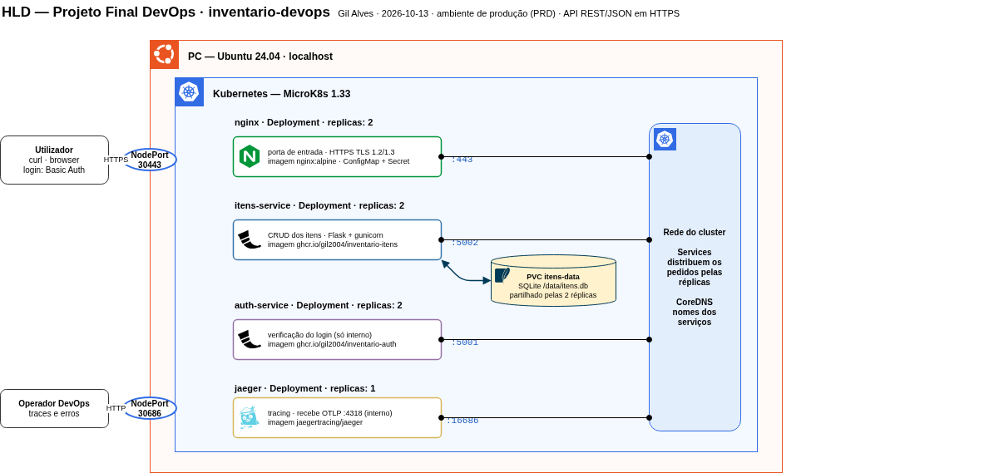

# Projeto Final DevOps — inventario-devops

**Autor:** Gil Alves · Tokio School · https://github.com/gil2004/Invent-rios-DevOps

## 1. A aplicação

API de gestão de inventário para pequenas empresas (nome, quantidade e preço dos itens).
Útil para uma startup porque substitui folhas de Excel partilhadas por uma API segura
(HTTPS e login), testada automaticamente e com alta disponibilidade.

Dois microsserviços Python (Flask) que comunicam por HTTP/JSON:
- **itens-service** — CRUD dos itens, guardados em SQLite;
- **auth-service** — verifica o login (só é acessível internamente).

## 2. Pipeline

Cada push para a `main` corre o GitHub Actions: **DEV** (lint + testes unitários) →
**STG** (build das imagens + testes de integração + publicação no GHCR) → aprovação
manual → **PRD** (deploy em Kubernetes, sem build, + smoke tests).

O build é feito uma só vez, em STG. O PRD não constrói nada: descarrega as imagens já
testadas e arranca-as, por isso o deploy é rápido.

No GitHub Actions, o job PRD demora mais do que o deploy em si, porque cada job corre
numa máquina nova e vazia: antes do deploy tem de **instalar o MicroK8s**, o que ocupa a
maior parte do tempo do job. Num ambiente de produção real o cluster já existe e está
sempre ligado (como o MicroK8s do PC), por isso subir o PRD é só o passo de deploy:
`kubectl apply` com as imagens prontas, sem build.

## 3. Arquitetura (PRD)

Kubernetes (MicroK8s) com 2 réplicas de nginx, itens-service e auth-service, e 1 de
Jaeger. Entradas: **30443** (API em HTTPS) e **30686** (Jaeger). A porta 80 está fechada.

## 4. Passos

### Passo 1 — DEV: desenvolver e testar · `make start_dev`
O código é desenvolvido no PC (Ubuntu 24.04, VS Code), num **venv** com Python 3.12 e o
`requirements.txt`. O `make start_dev` cria o venv, instala as dependências, corre o
lint (ruff) e os testes unitários de cada serviço isolado. **5 + 17 testes aprovados.**

### Passo 2 — STG: build e testes · `make start_stg`
Faz o **build** das imagens a partir dos `Dockerfile` e sobe o ambiente com **Docker
Compose**: nginx com HTTPS (certificado self-signed), 2 réplicas de cada serviço,
SQLite num volume e Jaeger. Depois corre os testes de integração através do nginx:
CRUD completo, login errado recusado e porta 80 fechada. **5 testes aprovados.**
No pipeline, as imagens aprovadas são publicadas no GHCR.

### Passo 3 — PRD: subir o ambiente · `make start_prd`
Liga o **Kubernetes (MicroK8s)**, carrega a configuração do nginx e o certificado e
aplica o `k8s/prd.yml`. O Kubernetes **descarrega do GHCR as imagens testadas em STG,
sem build**, e arranca 7 pods. Os smoke tests confirmam que está tudo a funcionar.
**4 testes aprovados.**

### Passo 4 — PRD: usar a aplicação · `make prd_demo`
API em `https://localhost:30443`. Criar, alterar e apagar exigem login (Basic Auth:
`admin` / `admin123`).

| Ação | Pedido | Login | Resposta |
|---|---|---|---|
| Listar | `GET /api/itens` | não | 200 |
| Criar | `POST /api/itens` | sim | 201 |
| Alterar | `PUT /api/itens/<id>` | sim | 200 |
| Apagar | `DELETE /api/itens/<id>` | sim | 204 |
| Palavra-passe errada | — | — | 401 |

### Passo 5 — Alta disponibilidade, escala e monitorização
- `make prd_ha` — apaga um pod: a API continua a responder e o Kubernetes cria outro.
- `make prd_scale` — escala o itens-service de 2 para 4 réplicas e volta a 2.
- `make jaeger_erro` — desliga o auth-service (resposta 503); no Jaeger
  (`http://localhost:30686`) o trace mostra a causa raiz: falha de ligação ao auth-service.

### Passo 6 — Paragem, destruição e limpeza · `make clean`
Apaga os recursos do Kubernetes, para o Docker Compose, limpa containers, volumes,
redes, imagens e cache do Docker, o venv e o certificado, e desliga o MicroK8s. No fim
confirma que a API e o Jaeger já não respondem.

`make all` executa os passos 1 a 4 seguidos.

## 5. Dificuldades e soluções

| Problema | Solução |
|---|---|
| Com réplicas, cada uma tinha itens diferentes (dados em memória) | SQLite num disco partilhado pelas réplicas |
| `curl` e testes recusavam o HTTPS (certificado self-signed) | confiar no certificado: `--cacert` e `REQUESTS_CA_BUNDLE` |
| O k3s não arrancava (portas ocupadas) | o PC já tinha o MicroK8s das aulas, que passou a ser usado |
| Testes falhavam depois do `make clean` (certificado antigo no nginx) | o `start_prd` reinicia o nginx depois de atualizar o certificado |
| Pipeline com "Invalid workflow file" | indentação do job PRD corrigida |

## 6. Limitações

Tudo corre num só PC: se o PC desligar, cai tudo. A evolução seria o Kubernetes em vários
nós e uma base de dados servidor (PostgreSQL) em vez de SQLite.

## 7. Utilização de IA

O código foi escrito com o apoio do Claude (Anthropic). As decisões, os testes e a
validação foram feitos pelo autor.