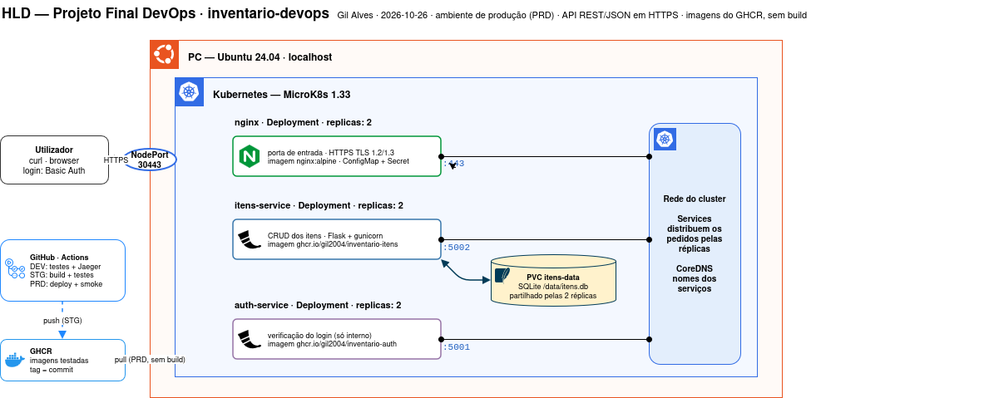

# Projeto Final DevOps — inventario-devops

**Autor:** Gil Alves · **Curso:** DevOps Engineering — Tokio School
**Repositório:** https://github.com/gil2004/Invent-rios-DevOps

## 1. A aplicação

Gestor de inventário para pequenas empresas: regista o material, o stock ou o equipamento
(nome, quantidade e preço). Qualquer pessoa pode consultar a lista, mas só quem tem login
pode criar, alterar ou apagar itens.

**Porque é útil para uma startup:** substitui folhas de Excel partilhadas por uma aplicação
web segura (HTTPS e login), testada automaticamente em cada alteração e que continua a
funcionar quando uma peça falha (réplicas em Kubernetes).

**O que o cliente vê:** a página **`https://localhost:30443/`**, com a lista de itens, e a
página **"Gerir"**, onde, depois do login, cria, altera e apaga itens. A API REST/JSON
(`/api/itens`) fica disponível para integrações com outros sistemas.

Três microsserviços Python (Flask), que comunicam por HTTP/JSON:

| Serviço | Função | Endpoints |
|---|---|---|
| **web-service** (5003) | interface web: a página do cliente | `GET /` · `GET /gerir` · formulários de criar, alterar e apagar |
| **itens-service** (5002) | CRUD dos itens, guardados em SQLite | `GET/POST /api/itens` · `GET/PUT/DELETE /api/itens/<id>` |
| **auth-service** (5001) | verifica o utilizador e a palavra-passe | `POST /api/verificar` (só interno) |

Para criar, alterar ou apagar é preciso login (Basic Auth: `admin` / `admin123`, que se
podem mudar com as variáveis `ADMIN_USER` e `ADMIN_PASSWORD` sem alterar o código). O
web-service e o itens-service perguntam ao auth-service se as credenciais estão corretas;
se não estiverem, a resposta é **401**.

## 2. Ciclo DevOps: DEV → STG → PRD

| Ambiente | Para que serve | Onde corre | Bibliotecas | Testes |
|---|---|---|---|---|
| **DEV** | desenvolver e testar o código | venv + Docker Compose (`docker-compose.dev.yml`) com **Jaeger** | `requirements-dev.txt` (inclui OpenTelemetry, bandit e pip-audit) | lint, unitários, segurança e tracing |
| **STG** | fazer o **build** das imagens de PRD e validar que passam nos testes | Docker Compose (`docker-compose.yml`) | imagens com `requirements-prd.txt`; testes com `requirements-stg.txt` | vulnerabilidades das imagens (Trivy) e integração |
| **PRD** | subir a app já pronta | Kubernetes (MicroK8s, `k8s/prd.yml`) | imagens só com `requirements-prd.txt` (Flask, gunicorn, requests) | nenhum: corre a imagem já testada em STG |

- **Requirements por ambiente:** as imagens de produção só têm as bibliotecas mínimas para a
  app correr.
- **OpenTelemetry e Jaeger só em DEV**, seguindo a nota do professor: *"nem mesmo se usa
  opentelemetry/Jaeger em PRD, porque servem mais para testes"*. O código da aplicação
  **não tem nada de OpenTelemetry**: em DEV, cada serviço arranca com
  `opentelemetry-instrument gunicorn ...` (no `docker-compose.dev.yml`), que envia os traces
  para o Jaeger por fora da aplicação. O STG não tem tracing porque valida a imagem exata de
  PRD.
- **Build uma só vez, em STG:** cada imagem leva a tag do commit e, depois de passar nos
  testes, é publicada no GitHub Container Registry (GHCR).
- **PRD só faz pull + up:** o Kubernetes vai buscar ao GHCR a imagem com a tag que o STG
  testou e sobe o ambiente. Sem build e sem testes.

## 3. Arquitetura (PRD)

| Componente | Réplicas | Função | Porta |
|---|---|---|---|
| **nginx** | 2 | única entrada, HTTPS (TLS 1.2/1.3) | **30443** (NodePort, externa) → 443 |
| **web-service** | 2 | interface web | 5003 (HTTP, interna) |
| **itens-service** | 2 | CRUD dos itens | 5002 (HTTP, interna) |
| **auth-service** | 2 | verificação das credenciais | 5001 (HTTP, interna) |
| **PVC itens-data** | — | disco persistente do SQLite, partilhado pelas réplicas | — |

**HTTPS só por fora, HTTP por dentro:** o TLS termina no nginx. Só a ligação do utilizador ao
nginx é cifrada (HTTPS, externa). Dentro do cluster, o nginx e os serviços falam em HTTP
(interno), numa rede que não está exposta. A porta 80 está fechada.

**Percurso de um pedido:** browser → HTTPS 30443 → nginx → (HTTP) web-service → (HTTP)
itens-service → (HTTP) auth-service para validar o login → SQLite → resposta pelo mesmo
caminho.

## 4. Ferramentas

| Ferramenta | Utilização |
|---|---|
| Python 3.12 + venv, Flask (com templates Jinja), gunicorn, requests, sqlite3 | aplicação |
| pytest, pytest-cov, requests-mock | testes unitários, de integração e cobertura |
| ruff | lint |
| **bandit** | análise de segurança do código |
| **pip-audit** | vulnerabilidades conhecidas nas bibliotecas de DEV, STG e PRD |
| **Trivy** | vulnerabilidades das imagens Docker (sistema operativo e pacotes) |
| OpenTelemetry (`opentelemetry-instrument`) + Jaeger v2 | rastreamento distribuído (só DEV) |
| Docker + Docker Compose | DEV e STG; imagens `python:3.12-alpine` |
| Kubernetes (MicroK8s 1.33) + kubectl | PRD: réplicas, self-healing, escala |
| nginx + openssl | entrada HTTPS com certificado self-signed |
| Git, GitHub, GitHub Actions, GHCR | repositório, pipeline e registo de imagens |
| Make | uma tarefa por fase de cada ambiente |
| draw.io | desenho da arquitetura |

## 5. Passos: implementação, build, testes e deploy

O Makefile segue o ciclo **build → start → stop → clean** em cada ambiente. Os resultados
dos testes ficam na pasta `reports/`.

### Passo 1 — Repositório e ambiente Python (DEV) · `make build_dev`
Repositório Git local ligado ao GitHub (branch `main`). O `make build_dev` cria o **venv**
com o `requirements-dev.txt` e faz o build das imagens de DEV.

### Passo 2 — DEV: testes de código e segurança · `make test_dev`
Corre **sem nenhum ambiente ligado** (poupa CPU e memória): lint (ruff), testes unitários
dos três serviços (pytest, com os outros serviços simulados por `requests-mock`), análise de
segurança do código (bandit) e das bibliotecas dos **três ambientes** (pip-audit sobre o
`requirements-dev.txt`, o `-stg` e o `-prd`).

### Passo 3 — DEV: ambiente com Jaeger · `make start_dev`
Sobe os três serviços e o Jaeger e testa que os traces chegam ao Jaeger. A página fica em
`http://localhost:5003` e o Jaeger em `http://localhost:16686`. O `make jaeger_erro`
desliga o auth-service para provocar um 503: no Jaeger, o trace mostra a causa raiz (falha
de ligação ao auth-service). Parar: `make stop_dev`.

### Passo 4 — STG: build e análise das imagens de PRD · `make build_stg`
Faz o build das imagens com o `requirements-prd.txt` e analisa-as com o **Trivy**. O
relatório mostra todas as vulnerabilidades; o build falha se houver alguma HIGH ou CRITICAL
com correção disponível.

### Passo 5 — STG: validar o ambiente · `make start_stg`
Sobe o nginx (443, HTTPS) e 2 réplicas de cada serviço e corre os testes de integração:
serviços ativos, página web e login, CRUD completo, login errado recusado, auth-service não
exposto e porta 80 fechada. Parar: `make stop_stg`.

### Passo 6 — Pipeline · `git push`
Cada push corre DEV → STG → PRD no GitHub Actions (secção 6). As imagens aprovadas em STG
são publicadas no GHCR com a tag do commit.

### Passo 7 — PRD: subir o ambiente (pull + up) · `make start_prd`
Liga o MicroK8s com os addons `dns` e `hostpath-storage`, guarda a configuração do nginx
(ConfigMap) e o certificado (Secret) e aplica o `k8s/prd.yml`. O Kubernetes faz o **pull**
das imagens validadas em STG e **sobe** os pods. Sem build e sem testes. Parar:
`make stop_prd`.

### Passo 8 — PRD: usar a aplicação
- Browser: **`https://localhost:30443/`** (lista) e **"Gerir"** (criar, alterar e apagar com
  login).
- `make prd_demo` — o mesmo pela API: criar (201), listar, alterar (200) e apagar (204) um
  item; login errado (401).
- `make prd_ha` — apaga um pod: a aplicação continua a responder e o Kubernetes cria outro.
- `make prd_scale` — escala o itens-service de 2 para 4 réplicas e volta a 2.

### Passo 9 — Paragem, destruição e limpeza · `make clean`
Para e destrói os três ambientes (`clean_dev`, `clean_stg`, `clean_prd`): recursos do
Kubernetes, containers, imagens, volumes e redes do projeto, a imagem e a cache do Trivy, a
cache de build, o venv, as caches e o certificado, e desliga o MicroK8s. No fim lista o que
existe para provar que ficou vazio e tenta aceder a DEV, Jaeger, STG e PRD — esses pedidos
**têm de falhar**. A limpeza remove **apenas o que é do projeto**, sem afetar outros
containers do PC.

`make all` executa seguidos os passos 1 a 5, 7 e o `prd_demo`, parando cada ambiente antes
do seguinte.

## 6. Pipeline (GitHub Actions)

Cada push para a `main` corre três jobs, com os ambientes `dev`, `stg` e `prd` do GitHub:

1. **DEV** — lint, unitários dos três serviços, bandit e pip-audit dos três ambientes; depois
   sobe o `docker-compose.dev.yml` com o **Jaeger** para o teste de tracing.
2. **STG** — build das imagens de PRD (tag = commit), **Trivy**, Docker Compose com os testes
   de integração e publicação das imagens aprovadas no GHCR.
3. **PRD** — só sobe o ambiente: aplica o `k8s/prd.yml` com a **tag do commit testado em
   STG** (pull + up).

Os jobs DEV e STG guardam os relatórios como *artifact* (`reports-dev`, `reports-stg`).

O certificado HTTPS está guardado nos **Secrets do GitHub** (`TLS_CRT` e `TLS_KEY`): o
pipeline não gera certificados, vai buscá-los ao cofre, como numa empresa.

O job PRD instala primeiro o MicroK8s porque o runner do GitHub é uma máquina nova e vazia
em cada execução, que simula o servidor de produção. Num servidor real, o cluster já existe
e está ligado, e o PRD faz apenas o *pull* da imagem testada e o `kubectl apply`.

## 7. Decisões de design

- **Interface web num microsserviço próprio** (web-service): não guarda dados, usa a API do
  itens-service e valida o login no auth-service. 
- **HTTPS só por fora** (porta 443 no nginx, NodePort 30443), **HTTP por dentro** do cluster.
  Certificado self-signed gerado com `openssl` (em produção real seria assinado por uma
  entidade de confiança). A chave privada nunca vai para o Git: no PC é gerada pelo Makefile
  e no pipeline vem dos Secrets do GitHub.
- **Kubernetes em PRD** — mantém o número de réplicas pedido, recria pods que falham,
  escala com um comando e distribui os pedidos pelas réplicas. O Docker Compose fica em DEV
  e STG, onde a simplicidade é mais importante.
- **2 réplicas de tudo, incluindo o nginx**, que é a única porta de entrada.
- **SQLite num disco partilhado (PVC)**, para todas as réplicas verem os mesmos dados e os
  dados sobreviverem à recriação dos pods.
- **Imagens mínimas:** base `python:3.12-alpine`, atualizações de segurança do sistema
  (`apk upgrade`) e o `pip` removido depois de instalar as bibliotecas (só serve para
  instalar, a app não precisa dele). Containers sem root (`appuser`).
- **Tag do commit** — garante que o PRD corre exatamente a imagem que passou nos testes de STG.
- **Testes de código e segurança sem ambiente a correr** — só o tracing (DEV) e a integração
  (STG) precisam do ambiente ligado.
- **Sem testes em PRD** — os testes ficam em DEV e STG; o PRD só sobe a imagem que o STG
  validou.
- **Três ficheiros de requirements** em vez de um `requirements.txt` único, como pedido na
  revisão do professor: cada ambiente instala só o que precisa.

## 8. Evidências (pasta `reports/`)

| Teste | Ambiente | Ficheiro | Resultado |
|---|---|---|---|
| Lint (ruff) | DEV | `dev-lint.txt` | sem erros |
| Unitários | DEV | `dev-unitarios-*.txt` | auth 5 (95 %) · itens 17 (95 %) · web 10 (86 %) |
| Segurança do código (bandit) | DEV | `seguranca-bandit.txt` | 0 problemas |
| Bibliotecas (pip-audit) | DEV, STG, PRD | `seguranca-pip-audit-{dev,stg,prd}.txt` | 0 vulnerabilidades nos três |
| Tracing | DEV | `dev-tracing.txt` | os serviços enviam traces ao Jaeger |
| Imagens (Trivy) | STG | `stg-trivy-inventario-{auth,itens,web}.txt` | 0 vulnerabilidades |
| Integração | STG | `stg-integracao.txt` | 6 aprovados, incluindo página web e porta 80 fechada |
| Subida do PRD | PRD | `shell_output.txt` | 8 pods `Running` em segundos |
| Alta disponibilidade e escala | PRD | `shell_output.txt` | pod apagado e recriado sem parar; 2 → 4 → 2 réplicas |
| Pipeline | GitHub Actions | separador *Actions* | DEV ✅ · STG ✅ · PRD ✅ |

**Vulnerabilidades das imagens (Trivy), por imagem:**

| Imagem | Sistema operativo | Pacotes Python | Total |
|---|---|---|---|
| Antes: `python:3.12-slim` | 164 (44 HIGH) | 6 | **170** |
| Depois: `python:3.12-alpine`, com `apk upgrade` e sem `pip` | 0 | 0 | **0** |

## 9. Dificuldades e soluções

| Problema | Solução |
|---|---|
| Com réplicas, cada uma tinha itens diferentes | SQLite num disco partilhado pelas réplicas |
| `curl` e testes recusavam o HTTPS self-signed | confiar no certificado (`--cacert`, `REQUESTS_CA_BUNDLE`) |
| O k3s não arrancava (portas ocupadas) | usado o MicroK8s das aulas, já instalado |
| `make start_prd` falhava noutro PC (addons desligados) | o Makefile liga o `dns` e o `hostpath-storage` antes do deploy |
| pip-audit: vulnerabilidades no Flask, requests, pytest e OpenTelemetry | versões atualizadas nos requirements |
| Imagens com 170 vulnerabilidades (base Debian e `pip`) | base alpine, `apk upgrade` e `pip` removido da imagem |
| Dúvida sobre a app correr sem OpenTelemetry em STG/PRD | OpenTelemetry tirado do código; ligado só em DEV com `opentelemetry-instrument` |
| O nginx em PRD não arrancava ("host not found in upstream") | faltava o Service do itens-service no `prd.yml`; o log do pod mostrou a causa |
| Erros "(ignorado)" no `make clean` com o Kubernetes desligado | os alvos de PRD verificam primeiro se o MicroK8s está ligado |
| Cada job do pipeline corre numa máquina nova, sem o certificado | certificado guardado nos Secrets do GitHub |

## 10. Limitações e evolução

- Tudo corre num só PC: se o PC desligar, cai tudo. A evolução seria o Kubernetes em 3 ou
  mais nós (cluster em alta disponibilidade) e uma base de dados servidor (PostgreSQL) em vez
  de SQLite.
- Há um só utilizador de gestão. A evolução seria a gestão de vários utilizadores, com as
  palavras-passe guardadas em *hash* numa base de dados do auth-service.

## 11. Correções em relação às revisões anteriores

### Última revisão

| Nota do professor | Como foi resolvida |
|---|---|
| HLD: seta perdida por cima do 443; internamente usam-se portas não encriptadas | a linha passava por cima do texto `:443`; o HLD marca agora **HTTPS · externo** só na entrada do nginx e **HTTP · interno** nos serviços, com legenda "TLS termina no nginx" |
| Sem OpenTelemetry em STG/PRD, mas o código chamava `configurar_tracing` | o OpenTelemetry saiu do código; em DEV é ligado por fora com `opentelemetry-instrument` (secção 2) |
| SonarQube nos testes de segurança | sugestão não seguida; a segurança fica com bandit (código), pip-audit (bibliotecas) e Trivy (imagens) |
| Resultados dos testes só para PRD | pip-audit dos três ambientes e relatórios de DEV e STG em `reports/` (secção 8) |
| Não se testam as vulnerabilidades da imagem Docker | Trivy no `build_stg` e no pipeline; imagens de 170 para 0 vulnerabilidades |
| `shell_output` com "Erro 1 (ignorado)" no `stop_prd`/`clean_prd` | os alvos de PRD verificam se o Kubernetes está ligado; nenhum erro ignorado no Makefile |
| `build_prd` devia estar no `build_stg`; PRD só pull e up | `build_prd` removido; o build fica no `build_stg` e o `start_prd` só sobe o ambiente |
| "Só vejo `/api/itens` — é isto que o cliente vê?" | nova interface web (web-service) em `https://localhost:30443/` |

### Revisão anterior

| Nota do professor | Como foi resolvida |
|---|---|
| O ZIP não deve ter diretorias desnecessárias (`.git`) | ZIP sem `.git`, venv, caches nem certificados |
| Incluir os resultados dos testes de integração e de segurança | pasta `reports/` no ZIP |
| Make por ambiente: `build_`, `start_`, `stop_`, `clean_` | Makefile com o ciclo completo para DEV, STG e PRD |
| Requirements distintos para DEV/STG/PRD; sem OpenTelemetry/Jaeger em PRD | `requirements-dev/stg/prd.txt`; Jaeger só em DEV |
| DEV desenvolve e testa, STG faz o build e valida, PRD faz só o pull e sobe | secções 2, 5 e 6 |
| Não é preciso o ambiente a correr para os testes de código e segurança | `make test_dev` corre sem ambiente |
| `make start_prd` falhou (addons e timeout) | `make start_prd` liga os addons; diagnóstico automático se o deploy falhar |

## 12. Utilização de IA

O código foi escrito com o apoio do Claude (Anthropic). As decisões, a execução dos testes,
a validação e a revisão com base nas notas do professor foram feitas pelo autor.